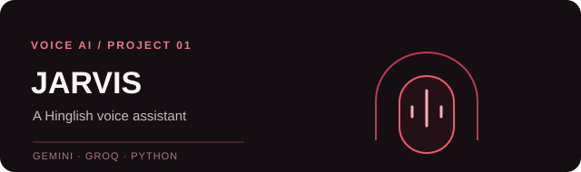
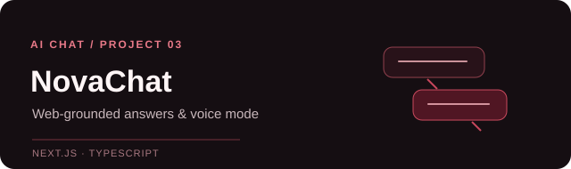
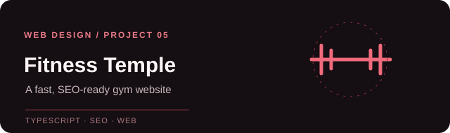

  

### Digital Marketer in India · AI Builder

**Growth strategy, SEO, content, and practical AI products.**

---

## What I do

- **Digital growth:** SEO, content strategy, and marketing ideas built around real goals.
- **AI products:** assistants and automations that make everyday tasks easier.
- **Web experiences:** clear, fast websites that connect the product with its audience.

## Selected work

<table>
  <tr>
    <td width="50%" valign="top">
      
      
<b>JARVIS · Voice AI</b> A Hinglish voice assistant with tools, memory, and vision. <a href="https://github.com/Krish-Khati/jarvis-ai">View project ↗</a>

    </td>
    <td width="50%" valign="top">
      
      
<b>Yojana Saathi · Civic AI</b> Helps people find government schemes in Hindi, Hinglish, and English. <a href="https://github.com/Krish-Khati/yojana-saathi">View project ↗</a>

    </td>
  </tr>
  <tr>
    <td width="50%" valign="top">
      
      
<b>NovaChat · AI Chat</b> Web-grounded answers and voice conversations. <a href="https://nova-chat-blue.vercel.app">Live demo ↗</a> · <a href="https://github.com/Krish-Khati/NovaChat">Source ↗</a>

    </td>
    <td width="50%" valign="top">
      
      
<b>Zedking Assistant · Automation</b> A bilingual Messenger bot grounded in real institute information. <a href="https://github.com/Krish-Khati/zedking-messenger-bot">View project ↗</a>

    </td>
  </tr>
  <tr>
    <td width="50%" valign="top">
      
      
<b>Fitness Temple · Web &amp; SEO</b> A fast website for gym training, classes, and coaching. <a href="https://fitness-temple-git-main-kisshu1.vercel.app/">Live demo ↗</a> · <a href="https://github.com/Krish-Khati/FITNESS_TEMPLE">Source ↗</a>

    </td>
    <td width="50%" valign="top">
      
      
<b>My Portfolio · Digital home</b> A home for my projects, experiments, and work. <a href="https://krish-portfolio-dev.vercel.app/">Visit site ↗</a>

    </td>
  </tr>
</table>

## My toolkit

| Focus | Tools &amp; skills |
|:--|:--|
| **Growth** | SEO · SEM · Content · Digital strategy |
| **AI** | Python · Gemini · Groq · AI assistants |
| **Web** | TypeScript · JavaScript · Next.js |

## A few things I enjoy

`AI that feels useful` &nbsp; `Hindi & Hinglish products` &nbsp; `Ideas that grow`

---

**Have a good idea? Let’s make it useful.**

[Portfolio](https://krish-portfolio-dev.vercel.app/) · [LinkedIn](https://linkedin.com/in/krish-khati) · [Email me](mailto:krrishai0916@gmail.com)

